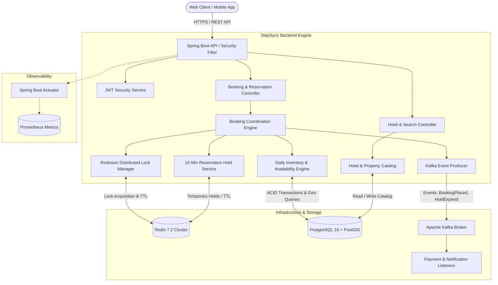
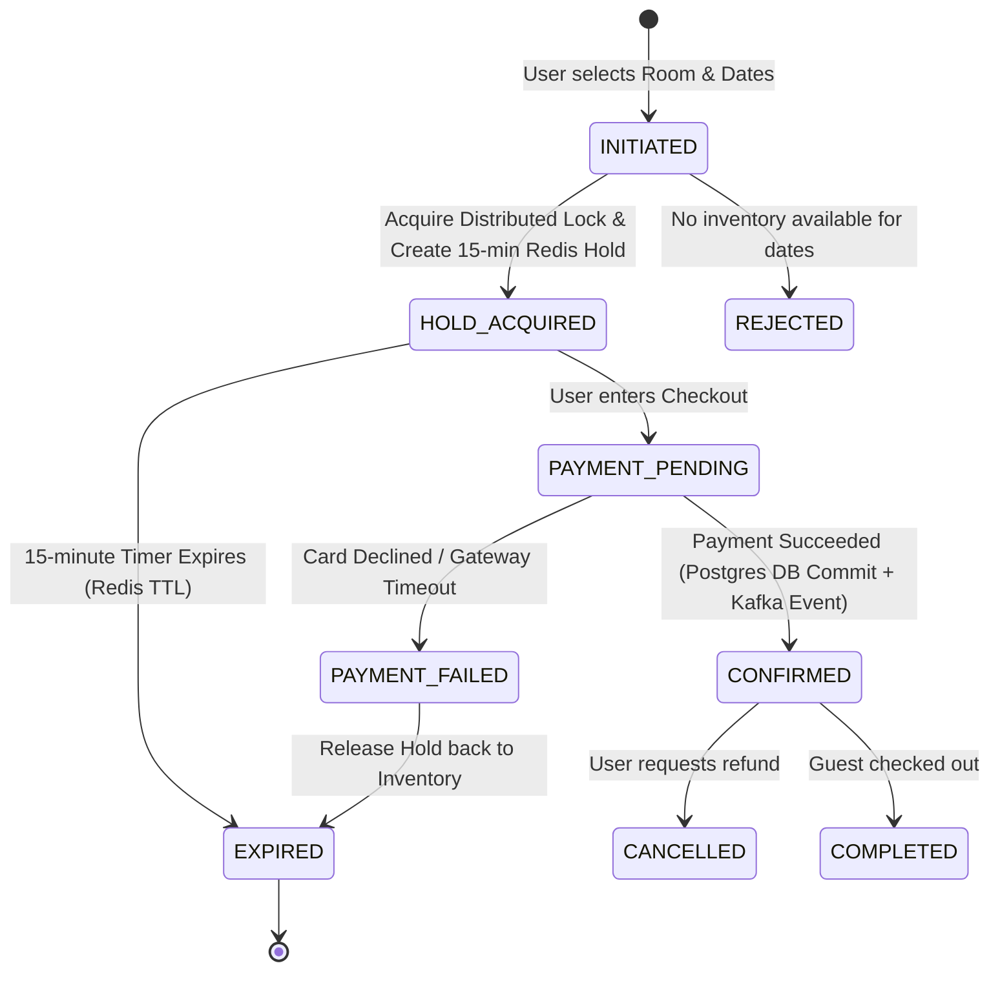

# StaySync Architecture & System Design Guide

> **Target Audience:** Backend Engineers & Interview Candidates  
> **Core Focus:** Distributed Systems, High Availability, Booking State Machine, and Domain-Driven Design (DDD).

---

## 1. High-Level System Architecture

StaySync is built as an **Event-Driven Modular Monolith** designed for high throughput, data consistency, and seamless transition to microservices when scaling requirements demand it.

---

## 2. Core Domain Models

In hospitality platforms (Booking.com, Airbnb), the domain cannot be modeled with a simple `Hotel` and `Room` table. Doing so makes checking date-range availability extremely slow and prone to race conditions.

StaySync separates concerns into 4 key domain entities:

### 1. `Hotel` (Property Catalog)
* **What is it?** Represents the physical property (e.g., "Grand Hyatt New York").
* **Attributes:** Name, description, address, city, country, latitude, longitude (Point geometry), star rating, active status.
* **Why this design?** Latitude and Longitude are stored as spatial coordinates to allow radius/bounding-box searches (e.g., "hotels within 5 km of Eiffel Tower").

### 2. `RoomType` (Inventory Unit)
* **What is it?** The classification of rooms sold under a hotel (e.g., "Deluxe King Suite", "Standard Twin").
* **Attributes:** `hotel_id`, name, base price, max capacity, total physical rooms owned by the hotel (`total_inventory`).
* **Why not track individual room numbers (e.g. Room 301)?**
  * *Booking.com reality:* Guests book a **Room Category**, not a specific room door number. The physical room is assigned at check-in. This enables inventory pooling and significantly higher booking throughput.

### 3. `DailyInventory` (The Availability Engine)
* **What is it?** A ledger tracking the total available rooms for each `(room_type_id, date)`.
* **Attributes:** `room_type_id`, `calendar_date`, `available_count`, `reserved_count`, `price_override`, `version` (for Optimistic Locking).
* **Why this design?**
  * If a hotel has 10 Deluxe rooms, and User A books Oct 20–22, querying whether rooms are free requires only checking that `available_count > reserved_count` for each day in that range.
  * This avoids expensive table scans across thousands of past booking rows.

### 4. `Booking` & `ReservationHold`
* **What is it?** The legal contract and temporary cart reservation between guest and hotel.
* **States:**
  * `HOLD_PENDING`: Room temporarily locked for 15 minutes while user enters payment details.
  * `CONFIRMED`: Payment cleared; inventory permanently deducted.
  * `EXPIRED`: User abandoned payment; hold released back to inventory.
  * `CANCELLED`: User cancelled prior to check-in; inventory restored.

---

## 3. The 15-Minute Checkout State Machine

A critical feature of Booking.com is that when you click "Reserve", the room is held for **15 minutes**. Other users cannot take it, but if you close your browser, the room is not locked forever.

---

## 4. Key Design Decisions & Trade-offs (For Interviews)

| Decision | Why We Chose It | What We Rejected & Why |
| :--- | :--- | :--- |
| **Modular Monolith over Microservices (Phase 1)** | Eliminates network latency, distributed transaction overhead, and debugging complexity while maintaining clear boundary modules (DDD). | **Pure Microservices:** Premature distributed complexity without organizational team scale. |
| **Inventory per Day Table** | $O(N)$ query where $N = \text{number of stay nights}$ (typically 1–14). Blazing fast range lookups with database index on `(room_type_id, calendar_date)`. | **Calculating availability dynamically from Bookings table:** Requires scanning all bookings for date overlaps, causing $O(M)$ table scans where $M = \text{millions of bookings}$. |
| **Redis Distributed Lock (Redisson)** | Fast in-memory atomic lock (`SET key val NX PX`). Releases automatically if JVM crashes. Prevents database thread starvation. | **Postgres `SELECT ... FOR UPDATE` exclusively:** Holding relational database row locks across HTTP requests causes connection pool exhaustion. |
| **Event-Driven Messaging via Kafka** | Decouples non-critical tasks (sending emails, updating hotel analytics, generating PDF invoices) from the critical booking path. | **Synchronous HTTP calls:** If the email server is slow or down, the booking API fails or times out for the user. |
