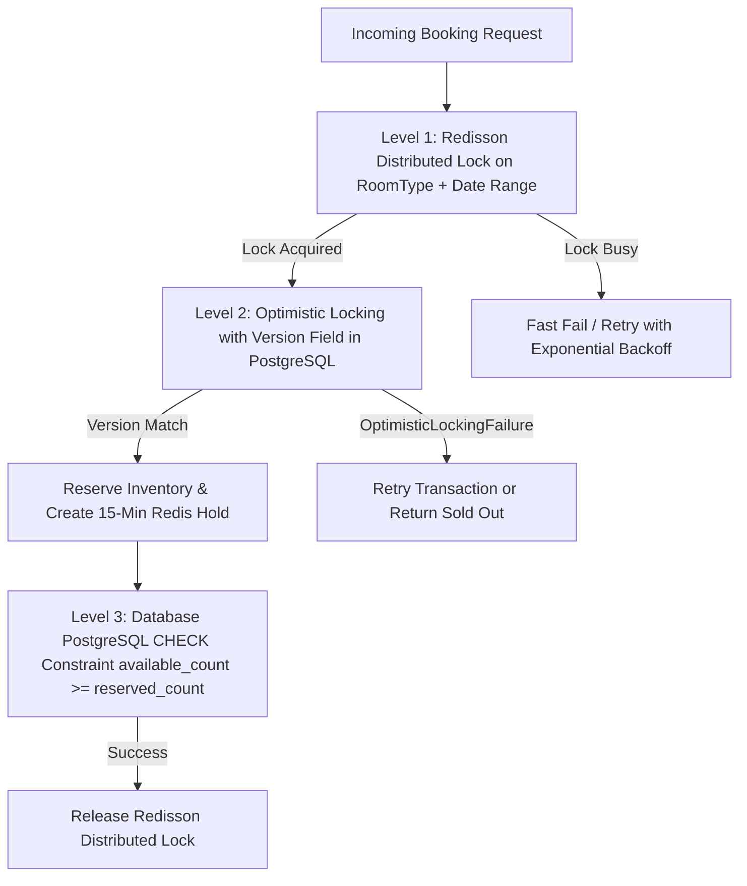

# Concurrency, Distributed Locking & Overbooking Prevention

> **Core Topic for Staff/Senior Backend Interviews:** How to prevent double bookings under high concurrent traffic spikes without degrading database performance.

---

## 1. The Real-World Problem: The Double-Booking Bug

Imagine the **Grand Hyatt** has **1 Deluxe Room left** for the night of December 31st.

At 12:00:00.000 PM:
* **User A** searches for Dec 31 and clicks **"Book Now"**.
* **User B** searches for Dec 31 and clicks **"Book Now"** at the exact same millisecond.

### What happens in a naive CRUD application?
```sql
-- Thread A (User A)
SELECT available_count FROM daily_inventory WHERE room_type_id = 10 AND calendar_date = '2026-12-31';
-- Returns 1

-- Thread B (User B)
SELECT available_count FROM daily_inventory WHERE room_type_id = 10 AND calendar_date = '2026-12-31';
-- Returns 1 (Race condition: Thread A hasn't committed yet!)

-- Thread A:
UPDATE daily_inventory SET available_count = 0 WHERE room_type_id = 10;
INSERT INTO bookings (guest_id, room_type_id, status) VALUES ('User_A', 10, 'CONFIRMED');

-- Thread B:
UPDATE daily_inventory SET available_count = 0 WHERE room_type_id = 10;
INSERT INTO bookings (guest_id, room_type_id, status) VALUES ('User_B', 10, 'CONFIRMED');
```
**Outcome:** **Catastrophe.** Two users have confirmed bookings for 1 room. The hotel must walk a guest to another property, pay damages, and suffer brand reputation loss.

---

## 2. The 3-Tier Defense Architecture in StaySync

StaySync uses a **defense-in-depth** strategy to guarantee zero double bookings while maintaining high throughput:



---

## 3. Deep Dive: Redisson Distributed Locks

### What is it?
A distributed lock ensures that only one server instance in a cluster can execute a critical section of code for a specific resource key at any given time.

### Why Redisson over raw Redis `SETNX`?
Raw Redis `SET key value NX PX 30000` has major flaws in production:
1. **The Expiration Problem:** If your database transaction takes 35 seconds, the lock expires after 30 seconds. Another thread acquires the lock while Thread A is still executing!
2. **The Wrong Release Problem:** Thread A finishes after 35 seconds and calls `DEL key`, accidentally deleting the lock belonging to Thread B!
3. **The Solution (Redisson Watchdog):**
   * Redisson uses Lua scripts to guarantee atomic lock acquisition and release.
   * It provides a **Lock Watchdog**: If a thread holds a lock, Redisson runs a background heartbeat that automatically extends the lock lease time until the thread explicitly releases it.
   * If the JVM crashes, the watchdog stops, and Redis expires the lock safely after the lease timeout.

### How it looks in StaySync:
```java
String lockKey = String.format("lock:room_type:%d:dates:%s_%s", roomTypeId, checkIn, checkOut);
RLock lock = redissonClient.getLock(lockKey);

boolean acquired = lock.tryLock(5, 15, TimeUnit.SECONDS);
if (!acquired) {
    throw new RoomUnavailableException("High booking traffic for this room. Please try again.");
}
try {
    // Critical Section: Check availability & hold inventory
    return inventoryService.holdInventory(roomTypeId, checkIn, checkOut, guestId);
} finally {
    if (lock.isHeldByCurrentThread()) {
        lock.unlock();
    }
}
```

---

## 4. Deep Dive: Optimistic Locking vs Pessimistic Locking

### 1. Optimistic Locking (`@Version`)
* **What is it?** We don't lock database rows upfront. Each `DailyInventory` row has a `version` integer.
* **How it works:**
  ```sql
  UPDATE daily_inventory 
  SET reserved_count = reserved_count + 1, version = version + 1
  WHERE id = :id AND version = :currentVersion AND (available_count - reserved_count) >= 1;
  ```
* **Pros:** Non-blocking. Other readers can read inventory at blazing speed.
* **Cons:** If 500 requests hit the same row at once, 499 will fail with `OptimisticLockingFailureException`.
* **Where we use it:** Combined with our Redis distributed lock, optimistic locking acts as the final safety net in case a distributed lock is bypassed.

### 2. Pessimistic Locking (`SELECT ... FOR UPDATE`)
* **What is it?** The database engine locks the row exclusively until the transaction commits or rolls back.
* **Why not use it for everything?**
  * Database connection pools (HikariCP) have limited threads (e.g., 20–50 connections).
  * If threads wait on database row locks, connections stay busy, starving the rest of the application and causing `ConnectionTimeoutExceptions`.

---

## 5. The 15-Minute Temporary Hold Architecture

When a user proceeds to checkout, we cannot immediately mark the booking as `CONFIRMED` because they haven't paid yet. But we also cannot leave the room open to the public.

### How StaySync implements the 15-Minute Hold:
1. **Atomic Increment in DB:** We increment `reserved_count` by 1 on the `DailyInventory` rows.
2. **Store Hold in Redis with TTL:**
   * Key: `hold:booking:{holdId}`
   * Value: `{ "roomTypeId": 10, "checkIn": "2026-12-31", "checkOut": "2027-01-01", "guestId": 123 }`
   * Expiration (TTL): `900 seconds` (15 minutes).
3. **If Payment Succeeds:**
   * Status changes from `HOLD` to `CONFIRMED`.
   * Redis hold key is deleted.
   * `reserved_count` stays deducted (or converted to `booked_count`).
4. **If 15 Minutes Elapse (Abandonment):**
   * A Spring scheduled job or Redis Keyspace notification (`__keyevent@0__:expired`) triggers a compensating transaction:
   ```sql
   UPDATE daily_inventory 
   SET reserved_count = reserved_count - 1 
   WHERE room_type_id = :roomTypeId AND calendar_date BETWEEN :checkIn AND :checkOut;
   ```
   * The room becomes available for booking again automatically.

---

## 6. Preventing Double-Payment (Idempotency Keys)

### The Problem:
A user's Wi-Fi drops while clicking "Confirm & Pay". They get anxious and click the button 3 times in 2 seconds.

### The Solution:
Every checkout request must include a unique header:
`X-Idempotency-Key: e8b94157-8b01-49b8-a612-421b8f04746f` (UUID generated on client page load).

Before processing payment:
```java
String idempotencyKey = request.getHeader("X-Idempotency-Key");
Boolean isFirstTime = redisTemplate.opsForValue()
    .setIfAbsent("idempotency:" + idempotencyKey, "PROCESSING", Duration.ofMinutes(30));

if (Boolean.FALSE.equals(isFirstTime)) {
    // Duplicate request! Either return cached response or reject.
    throw new DuplicateRequestException("Payment is already in progress for this request.");
}
```
If the first transaction succeeds, the result is cached in Redis against that key. Any retry returns the exact same success response without recharging the customer's credit card.
